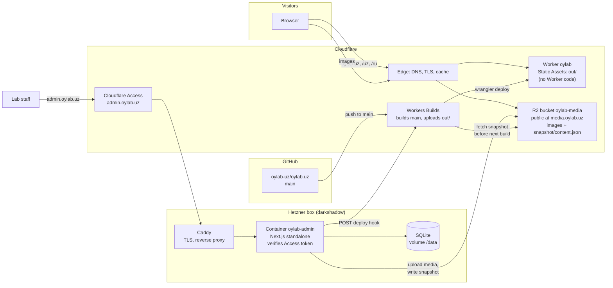
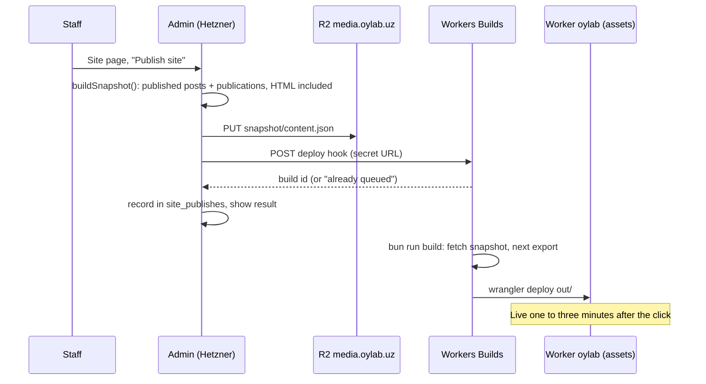

# How oylab.uz works

Two deployables, one repository. The **public site** is a static export served by
Cloudflare Workers Static Assets: no server code runs for a page view, so the site is
free at any traffic. The **admin** is a small Next.js server on the lab's Hetzner box,
behind Cloudflare Access. Publishing in the admin writes a snapshot of the published
content to R2 and asks Cloudflare to rebuild the static site from it.



## Repository layout

| Path | What it is | Runs where |
| --- | --- | --- |
| `apps/site` | Next.js 16, `output: "export"`, next-intl, Tailwind. The public site. | Built by Workers Builds, served as static files |
| `apps/admin` | Next.js 16, `output: "standalone"`, server actions, Drizzle on SQLite. The editor. | Docker container on the Hetzner box |
| `packages/content` | What both share: locale list, the snapshot contract, the Markdown pipeline, slug rules. | Compiled into both apps |
| `docs/` | This file, `DEPLOY.md` (runbook), `DESIGN.md` (visual design). | |

## The snapshot: the only coupling between admin and site

`packages/content/src/snapshot.ts` defines `Snapshot`: published posts and publications,
each with its translations and the body already rendered to HTML. The admin writes it to
R2 at `snapshot/content.json`; the site build downloads it with
`apps/site/scripts/fetch-snapshot.mjs` before `next build`, falling back to empty content
if it is missing, so the landing page always builds. Only published content is in it, which
is why it can be public and the build needs no secret.

## Public site

- `app/(en)` is the English root (`/`); `app/[locale]` serves `uz` and `ru` with
  `generateStaticParams`. Both render one `SiteShell`. `/en*` redirects with 301 via
  `public/_redirects`. `global-not-found.tsx` gives `out/404.html`, explicit pages give
  `out/uz/404.html` and `out/ru/404.html`; Workers serves the nearest one.
- Journal and publication pages are generated per locale from the snapshot. A missing
  translation shows the primary language with a notice; hreflang lists only existing
  locales and the canonical points at the primary language on fallback pages. An empty
  snapshot yields one placeholder slug per route (static export refuses zero params),
  redirected to the list.
- The moon phase and the footer year are computed in the browser after mount; the HTML
  carries a neutral disc of the same size.
- `public/_headers`: immutable caching for hashed chunks, 60 s revalidation for HTML,
  nosniff, referrer, frame, permissions and HSTS headers.

## Admin

- Routes: `/` dashboard, `/journal`, `/journal/[id]`, `/publications`,
  `/publications/[id]`, `/media`, `/site`, plus `/healthz` and a development-only
  `/uploads/*`.
- Auth: Cloudflare Access gates the hostname. `src/proxy.ts` rejects every request without
  a valid `Cf-Access-Jwt-Assertion` (JWKS from the team domain, audience checked), and
  `getIdentity()` verifies it again to name the author. No request header is trusted. In
  development (`next dev`) the gate is open and the identity is `ADMIN_DEV_EMAIL`.
- Data: SQLite at `DATABASE_PATH` (a Docker volume), migrated on first use from
  `drizzle/`. Tables: `posts`, `post_translations`, `publications`,
  `publication_translations`, `media`, `site_publishes`.
- Content rules: one primary language per item plus optional translations; slugs derive
  from the primary title and lock once published; Markdown (GFM, KaTeX, fenced code) is
  rendered to HTML on save by the shared pipeline, so the preview equals the output.
- Media: uploads go to R2 through its S3 API (`aws4fetch`) under `YYYY/MM/<id>.<ext>`
  and are served from `media.oylab.uz`; without R2 credentials, files go to
  `data/uploads` (development).

## Publishing



A push to `main` runs the same build, so code changes and content changes share one
pipeline. Without a deploy hook configured, the snapshot is still written and the next
push picks it up.

## Local development

```
bun install
bun run dev            # site on http://localhost:3000, empty or last fetched snapshot
bun run dev:admin      # admin on http://localhost:3300, SQLite in apps/admin/data
bun run --filter admin seed
bun run test        # content package + admin unit tests
```

To see admin content on the local site: publish in the admin (writes
`apps/admin/data/uploads/snapshot/content.json`), then
`SNAPSHOT_URL=file://$PWD/apps/admin/data/uploads/snapshot/content.json bun run build`.
